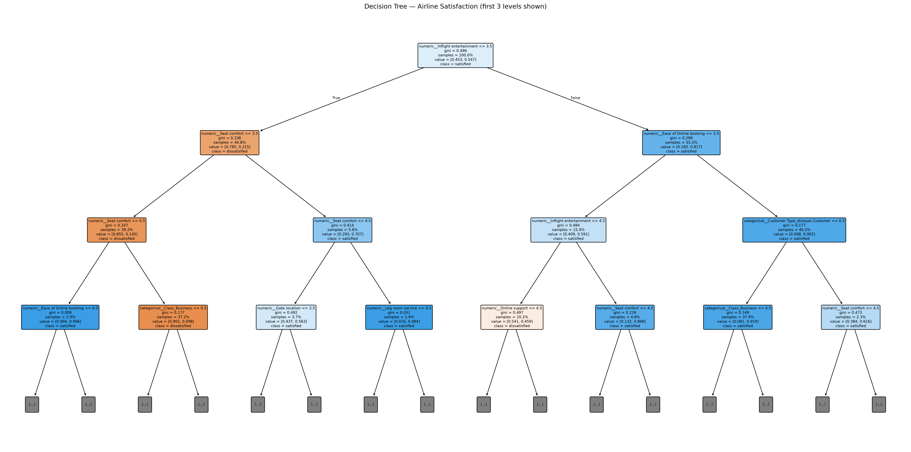
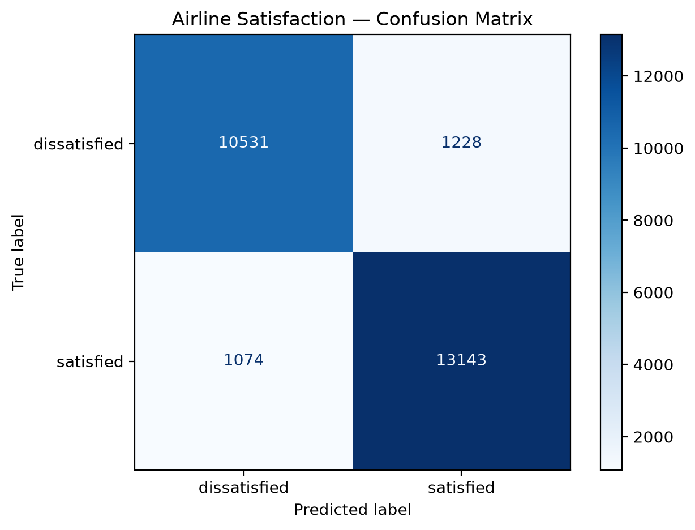

# Airline Customer Satisfaction Prediction

A machine learning project that uses a **Decision Tree Classifier** to predict airline passenger satisfaction from the `Invistico_Airline.csv` dataset.

The project demonstrates a complete classification workflow with pandas and scikit-learn: data preparation, missing-value imputation, categorical encoding, model selection, evaluation, feature importance, and decision-tree visualization.

## Project Overview

- **Problem type:** Supervised machine learning — binary classification
- **Dataset:** `Invistico_Airline.csv`
- **Target variable:** `satisfaction`
- **Model:** `DecisionTreeClassifier`
- **Training/testing split:** 80% / 20%
- **Random state:** `42`

The target column contains the passenger satisfaction class (for example, `satisfied` or `dissatisfied`).




## Features

- Loads the dataset with pandas.
- Automatically detects numerical and categorical predictor columns.
- Removes rows where the target value is missing.
- Imputes missing numerical values using the median.
- Imputes missing categorical values using the most frequent value.
- Encodes categorical variables with `OneHotEncoder`.
- Uses a scikit-learn `Pipeline` and `ColumnTransformer` to keep preprocessing inside cross-validation and prevent data leakage.
- Tunes Decision Tree hyperparameters with `GridSearchCV`.
- Evaluates the selected model on a held-out test set.
- Prints feature importances.
- Saves a decision-tree diagram, a confusion-matrix plot, and a CSV of feature importances.

## Project Structure

```text
decision-tree-airline/
├── Invistico_Airline.csv
├── decision_tree_airline.py
├── README.md
└── decision_tree_output/
    ├── decision_tree.png
    ├── confusion_matrix.png
    └── feature_importances.csv
```

The `decision_tree_output/` directory and its files are generated when the script runs.

## Requirements

- Python 3.9 or later
- pandas
- scikit-learn
- matplotlib

Install the dependencies:

```bash
python -m pip install pandas scikit-learn matplotlib
```

## How to Run

1. Clone or download this project.
2. Place `Invistico_Airline.csv` in the project directory (or note its file path).
3. Install the required packages.
4. Run the script:

```bash
python decision_tree_airline.py
```

To specify a different dataset path:

```bash
python decision_tree_airline.py --data "path/to/Invistico_Airline.csv"
```

To use a different target column:

```bash
python decision_tree_airline.py --target "satisfaction"
```

To choose another output directory:

```bash
python decision_tree_airline.py --output-dir "model_results"
```

You can combine these command-line options.

## Machine Learning Workflow

### 1. Data loading and preparation

The script loads the CSV file and checks that the configured target column exists. Rows with a missing target are removed because they cannot be used as labeled examples.

Feature columns are automatically separated by data type:

- **Numerical features:** columns with numeric pandas data types.
- **Categorical features:** text, category, Boolean, and other non-numeric columns.

### 2. Preprocessing

Preprocessing is performed within the scikit-learn pipeline:

| Feature type | Missing-value strategy | Encoding |
|---|---|---|
| Numerical | Median imputation | Not required |
| Categorical | Most frequent value | One-hot encoding |

`OneHotEncoder(handle_unknown="ignore")` allows the model to handle categories that were not present during training.

Keeping preprocessing in the pipeline is important: during cross-validation, each fold learns its imputation values and encoding from its training portion only. The test set is not used to fit preprocessing.

### 3. Train/test split

The dataset is split into:

- 80% training data
- 20% testing data

The split uses `random_state=42` for reproducibility and `stratify=y` to preserve the target-class proportions.

### 4. Model training and hyperparameter tuning

The project uses `DecisionTreeClassifier` with a fixed random state.

`GridSearchCV` evaluates combinations of these parameters:

| Parameter | Values tested | Purpose |
|---|---|---|
| `max_depth` | `3`, `5`, `8` | Limits tree depth and complexity |
| `min_samples_leaf` | `5`, `10` | Sets the minimum number of samples in a leaf |
| `criterion` | `gini` | Measures split quality |

The search uses 3-fold cross-validation and weighted F1 as its scoring metric. The best estimator is refitted on the full training set.

These settings are a starting point for controlling overfitting; they do not guarantee that the model will generalize well.

### 5. Model evaluation

The selected model is evaluated against the untouched test set. The script reports:

- **Accuracy:** proportion of all predictions that are correct.
- **Precision:** proportion of predicted examples in a class that actually belong to that class.
- **Recall:** proportion of actual examples in a class that the model correctly identifies.
- **F1-score:** harmonic mean of precision and recall.
- **Confusion matrix:** counts of correct and incorrect predictions for each class.

The classification report provides precision, recall, and F1-score for each class, along with macro and weighted averages.



### 6. Feature importance

The script extracts the fitted tree's `feature_importances_` values and prints the 20 highest-ranked transformed features. One-hot encoding means a categorical source column can appear as multiple encoded features.

Feature importance indicates how much a feature contributes to the tree's splits. It does not establish causation and can be biased toward some feature types or high-cardinality variables.

### 7. Visualizations and output files

After training, the script creates the output directory and saves:

| File | Description |
|---|---|
| `decision_tree.png` | Visualization of the first three levels of the fitted tree |
| `confusion_matrix.png` | Confusion matrix for test-set predictions |
| `feature_importances.csv` | Feature importance values sorted in descending order |

The tree visualization is limited to three displayed levels to make the diagram easier to read. This display limit does not change the trained model.

## Reproducibility

The script uses `random_state=42` for the train/test split and Decision Tree estimator. Results can still vary if the dataset, package versions, or configuration changes.

## Technologies

- [Python](https://www.python.org/)
- [pandas](https://pandas.pydata.org/)
- [scikit-learn](https://scikit-learn.org/)
- [Matplotlib](https://matplotlib.org/)

## Disclaimer

This project is intended for educational and analytical purposes. Model performance should be assessed using the actual test results and the needs of the intended application before using predictions in operational decisions.
